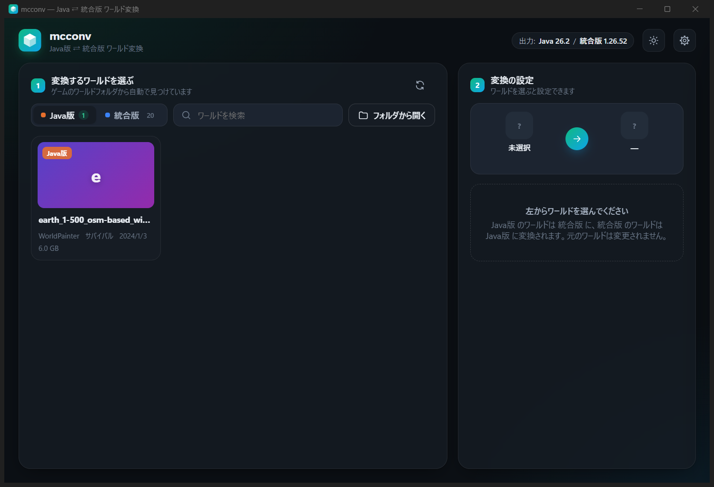
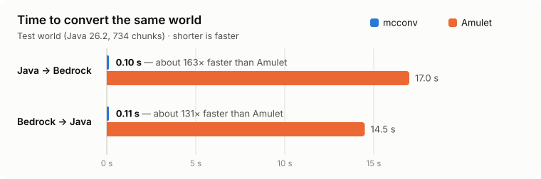

# mcconv — Minecraft Java ⇔ Bedrock world converter

[日本語](README.md) | **English**

mcconv converts **Minecraft Java Edition worlds to Bedrock Edition** and **Bedrock Edition worlds to Java Edition**.
Double-click it, pick a world, press a button — that's it.

- **Fast** — about 130–160× faster than Amulet on the same world. A 6 GB world takes about 30 seconds ([benchmarks](#speed-and-accuracy))
- **Accurate** — converted worlds are checked by loading them in the real Bedrock and Java servers
- **Easy** — a single exe, no installation. It finds the worlds on your PC and saves the result straight into the game's world list



> The app's interface is currently in Japanese. The labels used below are given with their Japanese text.

## How to use

1. Download `mcconv-windows-x64.zip` from [Releases](../../releases) and extract it anywhere.
2. Double-click `mcconv.exe`.
   - If "Windows protected your PC" appears, click "More info" → "Run anyway" (shown for apps without a code signature).
3. The Java and Bedrock worlds on your PC are listed on the left. Click the world you want to convert.
   - For a world stored elsewhere, use "Open folder" (フォルダから開く).
4. Press "Start conversion" (変換を開始) on the right.
5. When it finishes, start the game. The converted world is in your world list.

The original world is never modified. Do not open the world in the game while it is being converted.

- The three buttons at the top right (screen / sun / moon) set the theme: follow the system, light or dark.
- The selected world's thumbnail and version are shown in the conversion settings.
- For Bedrock → Java, the Java version to write is chosen in the conversion settings. Java → Bedrock always writes for the newest Bedrock Edition.
- Worlds newer than mcconv supports show a warning.
- "Block replacement" (ブロックの置き換え) converts chosen blocks into other blocks (see below).
- "Advanced settings" (詳細設定) lets you limit the CPU threads and memory used (useful if you want to keep using your PC during a conversion).
- The game version to write can be chosen in the settings (gear icon).

### After a Minecraft update

Open the settings (gear icon) → "Update from installed games" (インストール済みのゲームから更新). mcconv downloads the latest mapping data and supports the new blocks.
For Java Edition, launch that version once in the official launcher first.

## Supported versions

| | Supported |
|---|---|
| Worlds written | Java 26.3 (1.21.1 to 26.2 can also be chosen) / the newest Bedrock (the installed game, else 1.26.60) |
| Worlds read | Java 1.18 to 26.3 / Bedrock 1.18 or later |
| OS | Windows 10 / 11 (the window uses WebView2, which is built into Windows 11) |

For newer Java versions, mcconv writes the newest save format it knows (26.2), and the game upgrades the world to its own format when it opens it.

### Writing older Java versions

When converting Bedrock → Java, older versions such as 1.21.1 can be chosen under "Java version to write" in the conversion settings, or with `-java-version 1.21.1` on the command line.
Blocks, items and biomes that version does not have are replaced with similar ones (for example pale oak → dark oak, pale garden → dark forest), and the replaced blocks are listed after the conversion. Entities that version does not have are not converted.
Sign text, item names, equipment, boats, furnaces, level.dat and the folder layout are written in that version's format too.

### Block replacement

In the conversion settings, open "Block replacement" (ブロックの置き換え), press "Add row" (行を追加), and enter a source block ID on the left and the replacement block ID on the right.
Example for Java → Bedrock: `barrier` → `invisible_bedrock`.

- The left ID is from the source edition, the right ID from the target edition. Suggestions appear as you type, and `minecraft:` can be left out.
- For Java → Bedrock, a Java ID on the right is converted to the matching Bedrock block.
- Properties such as facing, half or waterlogged are kept when the replacement block has them; otherwise it gets its default state.
- The contents of replaced blocks (chest items, sign text, ...) are dropped.
- Unknown IDs are shown in red and must be fixed before converting. The number of replaced blocks is shown after the conversion.
- Only blocks in the world are replaced, not items in inventories.

On the command line, use `-replace barrier=invisible_bedrock,chest=barrel`.

## What is converted

- Blocks (every state, including waterlogged blocks) and biomes
- Block entities: chests (including double chests), sign text, banner patterns, bed colors, flower pots, note blocks, heads, spawners, container contents, loot tables, custom names and more
- Items: count, durability, enchantments, potions, names and lore, dye colors, shulker box contents, books
- Entities: mobs, dropped items, minecarts, boats, armor stands, falling blocks, paintings, item frames
- level.dat: name, seed, spawn point, game mode, difficulty, time, weather, main game rules, superflat settings

Information that Bedrock does not store (leaf distance, fence and stair connections, snowy grass, kelp and vine stems, etc.) is calculated during conversion or left for Java Edition to recalculate when it loads the world.

Not converted: player data (inventory, position), villager professions and trades, temporary entities such as arrows.

## Command line

When run with arguments, mcconv converts without opening a window.

```
mcconv [options] <input world> <output world (empty folder)>
mcconv update-data          (update the mapping data after a game update)
```

The edition of the input is detected automatically and it is converted to the other edition.

| Option | Description |
|---|---|
| `-name NAME` | Name of the converted world (default: the original name) |
| `-dims overworld,nether,end` | Dimensions to convert |
| `-workers N` | Number of threads (default: the number of CPU threads) |
| `-mem MB` | Memory limit (default: no limit; a lower limit makes conversion slower) |
| `-compression -2..9` | Output compression level (default 1; 0 = no compression) |
| `-all-chunks` | Also convert chunks that are not fully generated |
| `-v` | Show the time taken by each step |
| `-java-version 1.21.1` | Java version to write (1.21.1 or later; default: `versions.json`, else the tables' version) |
| `-replace from=to,from=to` | Replace blocks (e.g. `barrier=invisible_bedrock`; source edition ID = target edition ID) |
| `-data DIR` | Folder for settings and updated data (default: `mcconv-data` next to the exe) |

### Settings files (mcconv-data folder)

- `versions.json` the Java version the command line writes (the window asks for each conversion; Bedrock is always written for the newest version)
- `tables.json.gz` updated mapping tables (created by `update-data`; the built-in tables are used if it is missing)
- `bedrock_entities.json` Bedrock entity definitions (read from the installed Bedrock Edition)
- `overrides.json` your own ID mappings, for blocks and other IDs missing from the tables:
  ```json
  {
    "blocks":   {"java_to_bedrock": {"minecraft:new_block": "minecraft:bedrock_name"}, "bedrock_to_java": {}},
    "items":    {"java_to_bedrock": {}, "bedrock_to_java": {}},
    "entities": {"java_to_bedrock": {}, "bedrock_to_java": {}}
  }
  ```

## Speed and accuracy

<picture>
  <source media="(prefers-color-scheme: dark)" srcset="docs/bench-en-dark.svg">
  
</picture>

### Same world

| Test world (Java 26.2, 734 chunks) | Amulet | mcconv | |
|---|---:|---:|---:|
| Java → Bedrock | 17.0 s | **0.10 s** | about 163× faster |
| Bedrock → Java | 14.5 s | **0.11 s** | about 131× faster |

### Large worlds

| World | Java → Bedrock | Bedrock → Java | Amulet, estimated \*1 |
|---|---:|---:|---:|
| earth_1-500 (6 GB, 487,424 chunks) | **about 25 s** | **about 33 s** | about 3 hours |
| Whole Earth (112 GB, 11,063,296 chunks) | **about 14.5 min** | **about 15 min** \*2 | about 2.5–3 days |

- Converts about **20,000 chunks per second** (Java → Bedrock). It uses every CPU core and stays almost as fast as worlds get bigger.
- Memory use is usually 1.5–6.5 GB. Setting a memory limit in "Advanced settings" keeps it around 1.5 GB (conversion becomes somewhat slower).

\*1 The Amulet figures are estimates from its speed on the test world above (about 43–51 chunks per second); they were not measured.
\*2 Measured without writing the output files, because the output drive did not have enough free space (compression is included). These two rows were also measured before libdeflate was added.

### Accuracy checks

Converted worlds are checked not only by mcconv itself but by loading them in the real game servers.

| Check | Result |
|---|---|
| Loaded in Bedrock Dedicated Server 1.26.52 | Test world and earth_1-500 load and shut down without errors |
| Loaded in the Java server (26.2) | Test world and earth_1-500: 0 warnings |
| Round trip Java → Bedrock → Java | 99.92% of 72.15 million blocks match the original. The differences are only information Bedrock lacks (`cave_air` becomes normal air, leaf distance is recalculated, the facing of buttons on the floor) |
| Compared with Amulet's output (Bedrock → Java) | 99.99% match. The difference is leaf distance (Amulet writes 7, the value that makes leaves decay; mcconv calculates it from nearby logs) |

### Why it is fast

- All chunks are sorted in Bedrock's storage order, converted on every CPU core at once, and written straight into the database files (no temporary files, no re-sorting)
- Block conversion results are remembered, so the same block is never converted twice
- A fast library (libdeflate) decompresses and recompresses the data, and block indices are packed with the CPU's SIMD instructions
- Files are memory-mapped, so reading copies less data

### Test environment

- Laptop: Intel Core Ultra 7 255H (16 threads), 64 GB RAM, Windows 11, measured with no other work running
- Amulet: the time of `load_level` → `save` with the amulet-core 1.9.40 Python library (the conversion engine of Amulet Map Editor 0.10). Its version check was relaxed so it could read 26.2 worlds
- Amulet and mcconv were measured on different days. Differences from the PC's state are around 10–20% and do not change the scale of the speed-up
- The charts can be redrawn with `go run ./tools/benchchart`

## Building from source

Requires [Go](https://go.dev/) 1.26 or later.

```
set GOEXPERIMENT=simd
go build -trimpath -ldflags "-H windowsgui -s -w -extldflags=-static" -o mcconv.exe ./cmd/mcconv
go test ./...
```

With a C compiler (such as MinGW-w64 gcc), the build uses [libdeflate](https://github.com/ebiggers/libdeflate) (MIT, bundled in `internal/deflate/libdeflate`) for zlib / deflate, which is about 10% faster and makes the output about 10% smaller.
`-extldflags=-static` links it into the exe, so the result is still a single exe. Without a C compiler (`CGO_ENABLED=0`) a pure Go version is built.

`GOEXPERIMENT=simd` makes the bit packing of block indices (`internal/bitpack`) use the CPU's SIMD instructions (AVX2). It builds without it too; then, and on CPUs without AVX2, the normal code is used.

`-H windowsgui` stops a black console window from appearing on double-click (output is still shown when run from a command line).
Pushing a tag (such as `v1.0.0`) to GitHub makes Actions build the exe and publish a zip on Releases (`.github/workflows/release.yml`).

To rebuild the icon and manifest (`cmd/mcconv/rsrc_windows_*.syso`):

```
go run ./tools/genicon cmd/mcconv/winres/icon.png
cd cmd/mcconv && go run github.com/tc-hib/go-winres@latest make --arch amd64,arm64
```

The built-in mapping tables (`internal/translate/data/tables.json.gz`) are made by `tools/gendata` from the sources in [Data sources](#data-sources) and the output of the Java Edition data generator. `mcconv update-data` does the same at run time.

### Layout

- `internal/gui` the window (WebView2; the page is `ui/index.html`). Conversions run the same exe as a child process, which reports progress as JSON
- `internal/translate` loading the tables, converting blocks / items / biomes, upgrading old Bedrock block states, converting text formatting
- `internal/convert` the parallel conversion, block entities, items, entities, leaf distance and similar calculations
- `internal/java`, `internal/bedrock` reading and writing chunks and level.dat for each edition
- `internal/nbt`, `internal/leveldb`, `internal/anvil`, `internal/zfast` NBT, LevelDB, region files, fast deflate decoding
- `internal/update` `update-data` (downloading and building the tables)
- `tools/` development tools: building the tables (`gendata`), comparing worlds (`compare`), printing NBT (`nbtdump`) and more

## Data sources

| Data | Source | License |
|---|---|---|
| Java ⇔ Bedrock block, item and biome mappings | [GeyserMC/mappings](https://github.com/GeyserMC/mappings) | MIT |
| Bedrock biome IDs, banner patterns, entity IDs | [pmmp/BedrockData](https://github.com/pmmp/BedrockData) | CC0 |
| List of every Bedrock block and its states | [GeyserMC/Geyser](https://github.com/GeyserMC/Geyser) | MIT |
| Upgrade rules for old Bedrock block states | [BedrockBlockUpgradeSchema](https://github.com/opencollab-incubator/BedrockBlockUpgradeSchema) | CC0 |
| Java block state list | Minecraft's data generator | — |
| Blocks, items, biomes and entities of older Java versions (1.21.1 to 26.1) | [PrismarineJS/minecraft-data](https://github.com/PrismarineJS/minecraft-data) | MIT |

Bedrock entity definitions are not bundled; they are read from the installed Bedrock Edition at run time.

## License

mcconv is free, including for commercial use. However, the [mcconv License](LICENSE) does not allow modification or redistribution.

- **No modification or redistribution** — please do not distribute modified versions or the exe elsewhere. To share mcconv, link to this repository
- **Credit (optional)** — not required, but if you publish converted worlds or use mcconv in videos or articles, a credit such as `World converted with mcconv by FacedFour1207` with this repository's URL is appreciated

The bundled libraries (klauspost/compress, libdeflate, go-webview2, etc.) and data are under their own licenses ([THIRD_PARTY_NOTICES.md](THIRD_PARTY_NOTICES.md)).

NOT AN OFFICIAL MINECRAFT PRODUCT. NOT APPROVED BY OR ASSOCIATED WITH MOJANG OR MICROSOFT.
Minecraft is a trademark of Mojang Synergies AB.
