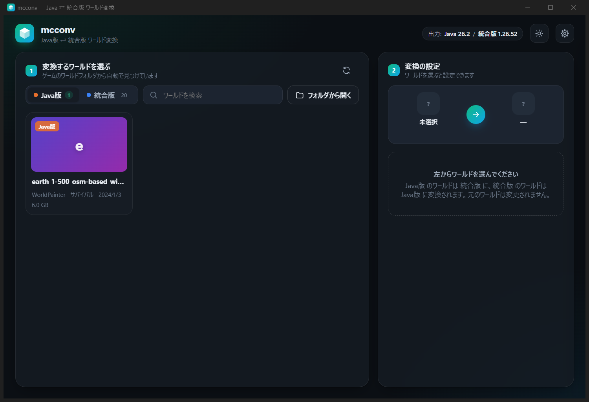
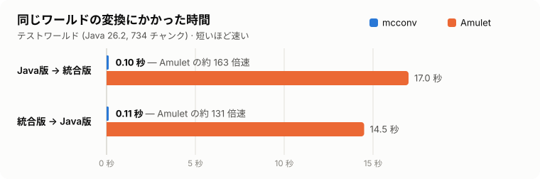

# mcconv — Minecraft Java版 ⇔ 統合版 ワールド変換

Minecraft の **Java版のワールドを統合版 (Bedrock) に**、**統合版のワールドを Java版に** 変換するツールです。
ダブルクリックで開く画面から、ワールドを選んでボタンを押すだけで変換できます。

- **速い** — 同じワールドの変換が Amulet の約 130〜160 倍速。6GB のワールドも約 30 秒です ([速さの比較](#速さと正確さ))
- **正確** — 変換したワールドを本物の Bedrock / Java サーバーで読み込んで確認しています
- **かんたん** — exe 1 つ。インストール不要で、PC 内のワールドを自動で見つけ、ゲームのワールド一覧に直接保存します



## 使い方

1. [Releases](../../releases) から `mcconv-windows-x64.zip` をダウンロードして、好きな場所に展開します。
2. `mcconv.exe` をダブルクリックします。
   - 「Windows によって PC が保護されました」と出たら、「詳細情報」→「実行」を押してください (署名のないアプリに出る表示です)。
3. 左側に、PC 内の Java版 と 統合版 のワールドが自動で並びます。変換したいワールドをクリックします。
   - ほかの場所にあるワールドは「フォルダから開く」で選べます。
4. 右側の「変換を開始」を押します。
5. 終わったらゲームを起動してください。変換したワールドがワールド一覧に出ています。

元のワールドは変更しません。変換中は、そのワールドをゲームで開かないでください。

- 右上の月 / 太陽のボタンでライト・ダークを切り替えられます。
- 「詳細設定」で、使う CPU スレッド数やメモリの上限を調節できます (変換中も PC を使いたいときに)。
- 書き出すゲームのバージョンは、設定 (歯車) の一覧から選べます。

### マインクラフトがアップデートされたら

右上の歯車 (設定) →「インストール済みのゲームから更新」を押すと、最新の対応表をダウンロードして新しいブロックに対応します。
Java版 は、そのバージョンを公式ランチャーで一度起動しておく必要があります。

## 対応バージョン

| | 対応 |
|---|---|
| 書き出すワールド | Java版 26.2 / 統合版 1.26.50 (新しいゲームでもそのまま開けます) |
| 読み込めるワールド | Java版 1.18 以降 / 統合版 1.18 以降 |
| OS | Windows 10 / 11 (画面表示に WebView2 を使います。Windows 11 には標準で入っています) |

## 変換されるもの

- ブロック (水没ブロックを含む全状態)・バイオーム
- ブロックエンティティ: チェスト (2 連結)、看板の文字、旗の模様、ベッドの色、植木鉢、音符ブロック、頭、スポナー、コンテナの中身、戦利品テーブル、カスタム名 など
- アイテム: 個数・耐久値・エンチャント・ポーション・名前と説明文・染色・シュルカーボックスの中身・本
- エンティティ: モブ、ドロップアイテム、トロッコ、ボート、防具立て、落下中のブロック、絵画、額縁
- level.dat: 名前・シード値・スポーン地点・ゲームモード・難易度・時刻・天気・主なゲームルール・スーパーフラット設定

統合版が保存していない情報 (葉の距離、フェンスや階段のつながり、雪の積もった草ブロック、昆布やツタの茎など) は、変換時に計算するか、Java版 が読み込み時に再計算するようにしています。

変換されないもの: プレイヤーのデータ (インベントリ・位置)、村人の職業と取引、矢などの一時的なエンティティ。

## コマンドラインで使う

引数を付けて実行すると、画面を開かずに変換します。

```
mcconv [オプション] <入力ワールド> <出力ワールド (空のフォルダ)>
mcconv update-data          (ゲームのアップデート後に対応表を更新)
```

入力がどちらの版かは自動で判定し、反対の版に変換します。

| オプション | 説明 |
|---|---|
| `-name 名前` | 変換後のワールド名 (既定: 元のワールド名) |
| `-dims overworld,nether,end` | 変換するディメンション |
| `-workers N` | 使うスレッド数 (既定: CPU のスレッド数) |
| `-mem MB` | メモリ使用量の上限 (既定: 制限なし。少なくすると変換は遅くなります) |
| `-compression -2..9` | 出力の圧縮レベル (既定 1。0 = 無圧縮) |
| `-all-chunks` | 生成途中のチャンクも変換する |
| `-v` | 各段階の所要時間を表示 |
| `-data DIR` | 設定・更新データのフォルダ (既定: exe と同じ場所の `mcconv-data`) |

### 設定ファイル (mcconv-data フォルダ)

- `versions.json` 書き出すワールドのバージョン (画面の設定からも変更できます)
- `tables.json.gz` 更新した対応表 (`update-data` が作成。無ければ内蔵の対応表を使います)
- `bedrock_entities.json` 統合版エンティティの定義 (インストール済みの統合版から読み込み)
- `overrides.json` 独自の ID 対応表。対応表にないブロックなどを指定できます:
  ```json
  {
    "blocks":   {"java_to_bedrock": {"minecraft:new_block": "minecraft:bedrock_name"}, "bedrock_to_java": {}},
    "items":    {"java_to_bedrock": {}, "bedrock_to_java": {}},
    "entities": {"java_to_bedrock": {}, "bedrock_to_java": {}}
  }
  ```

## 速さと正確さ

<picture>
  <source media="(prefers-color-scheme: dark)" srcset="docs/bench-dark.svg">
  
</picture>

### 同じワールドでの比較

| テストワールド (Java 26.2, 734 チャンク) | Amulet | mcconv | |
|---|---:|---:|---:|
| Java版 → 統合版 | 17.0 秒 | **0.10 秒** | 約 163 倍速 |
| 統合版 → Java版 | 14.5 秒 | **0.11 秒** | 約 131 倍速 |

### 大きなワールド

| ワールド | Java版 → 統合版 | 統合版 → Java版 | 参考: Amulet での目安 ※1 |
|---|---:|---:|---:|
| earth_1-500 (6GB、487,424 チャンク) | **約 25 秒** | **約 33 秒** | 約 3 時間 |
| 地球全体 (112GB、11,063,296 チャンク) | **約 14 分半** | **約 15 分** ※2 | 約 2.5〜3 日 |

- 1 秒あたり約 **20,000 チャンク** (Java版 → 統合版) を変換します。CPU のすべてのコアを使い、ワールドが大きくなっても速さはほとんど落ちません。
- メモリは通常 1.5〜6.5GB ほど使います。「詳細設定」でメモリの上限を決めると、1.5GB 程度に抑えられます (そのぶん変換は少し遅くなります)。

※1 Amulet の値は、上のテストワールドでの速さ (1 秒あたり約 43〜51 チャンク) をそのまま当てはめた推定で、実際には測っていません。
※2 出力先の空き容量が足りなかったため、ファイルへの書き込みを省いて計測しました (圧縮までは含みます)。また、この 2 行は libdeflate 導入前の版での計測です。

### 正確さの確認

変換結果は、ツール自身の読み込みだけでなく、本物のゲームサーバーに読み込ませて確かめています。

| 確認内容 | 結果 |
|---|---|
| 統合版サーバー (Bedrock Dedicated Server 1.26.52) で読み込み | テストワールドと earth_1-500 で、エラーなく読み込み・正常終了 |
| Java版サーバー (26.2) で読み込み | テストワールドと earth_1-500 で、警告 0 件 |
| Java版 → 統合版 → Java版 の往復 | 7,215 万ブロック中 99.92% が元と一致。違いは統合版にない情報だけ (洞窟内の空気 `cave_air` が普通の空気に、葉の距離を再計算、床に付いたボタンの向き) |
| Amulet の出力との比較 (統合版 → Java版) | 99.99% 一致。違いは葉の距離 (Amulet は 7 = 自然に消える値、mcconv は周りの原木から計算) |

### 速さの理由

- 全チャンクを統合版の保存順に並べて、CPU の全コアで同時に変換し、データベースのファイルを直接書き出す (一時ファイルや並べ替えのやり直しがない)
- ブロックの変換結果を覚えておき、同じブロックは二度計算しない
- 圧縮の展開・再圧縮に高速なライブラリ (libdeflate) を使い、ブロック番号の詰め込みには CPU の SIMD 命令を使う
- ファイルはメモリに直接割り当てて読む (読み込みのコピーが少ない)

### 計測環境

- ノート PC: Intel Core Ultra 7 255H (16 スレッド)、メモリ 64GB、Windows 11。ほかの作業をしていない状態で計測
- Amulet: amulet-core 1.9.40 (Amulet Map Editor 0.10 系の変換エンジン) の Python ライブラリで `load_level` → `save` を実行した時間。26.2 のワールドを読めるよう、バージョン判定だけ緩めて実行
- Amulet と mcconv は別の日に計測しています。PC の状態による差は 1〜2 割程度で、倍率の大きさは変わりません
- グラフは `go run ./tools/benchchart` で作り直せます

## ソースからビルド

[Go](https://go.dev/) 1.26 以降が必要です。

```
set GOEXPERIMENT=simd
go build -trimpath -ldflags "-H windowsgui -s -w -extldflags=-static" -o mcconv.exe ./cmd/mcconv
go test ./...
```

C コンパイラ (MinGW-w64 の gcc など) があると、zlib / deflate の展開と圧縮に [libdeflate](https://github.com/ebiggers/libdeflate) (MIT、`internal/deflate/libdeflate` に同梱) を使う版になり、約 1 割速く、出力も約 1 割小さくなります。
`-extldflags=-static` で exe に組み込まれるので、配布するのは exe 1 つのままです。C コンパイラがない場合 (`CGO_ENABLED=0`) は Go だけで書いた処理でビルドされます。

`GOEXPERIMENT=simd` を付けると、ブロック番号のビット詰め (`internal/bitpack`) に CPU の SIMD 命令 (AVX2) を使う版になります。付けなくてもビルドでき、その場合や AVX2 のない CPU では通常の処理で動きます。

`-H windowsgui` を付けると、ダブルクリックしたときに黒いコンソール画面が出ません (コマンドラインで実行した場合の出力はそのまま表示されます)。
GitHub でタグ (`v1.0.0` など) を push すると、Actions がビルドして Releases に zip を公開します (`.github/workflows/release.yml`)。

アイコンとマニフェスト (`cmd/mcconv/rsrc_windows_*.syso`) を作り直すとき:

```
go run ./tools/genicon cmd/mcconv/winres/icon.png
cd cmd/mcconv && go run github.com/tc-hib/go-winres@latest make --arch amd64,arm64
```

内蔵の対応表 (`internal/translate/data/tables.json.gz`) は `tools/gendata` で作ります。入力は下記の「データの出典」と、Java版 のデータジェネレーターの出力です。`mcconv update-data` も同じ処理を実行時に行います。

### 構成

- `internal/gui` 画面 (WebView2 のウィンドウ。画面は `ui/index.html`)。変換は同じ exe を子プロセスとして起動し、進み具合を JSON で受け取ります
- `internal/translate` 対応表の読み込み・ブロック/アイテム/バイオームの変換・統合版の古いブロック状態の更新・文字装飾の変換
- `internal/convert` 並列変換の処理、ブロックエンティティ・アイテム・エンティティの変換、葉の距離などの計算
- `internal/java`, `internal/bedrock` 各版のチャンクと level.dat の読み書き
- `internal/nbt`, `internal/leveldb`, `internal/anvil`, `internal/zfast` NBT・LevelDB・リージョンファイル・高速な deflate 展開
- `internal/update` `update-data` (対応表のダウンロードと作成)
- `tools/` 対応表の作成 (`gendata`)、ワールドの比較 (`compare`)、NBT の表示 (`nbtdump`) など開発用ツール

## データの出典

| データ | 提供元 | ライセンス |
|---|---|---|
| Java ⇔ 統合版のブロック・アイテム・バイオーム対応表 | [GeyserMC/mappings](https://github.com/GeyserMC/mappings) | MIT |
| 統合版のバイオーム ID・旗の模様・エンティティ ID | [pmmp/BedrockData](https://github.com/pmmp/BedrockData) | CC0 |
| 統合版の古いブロック状態の更新規則 | [BedrockBlockUpgradeSchema](https://github.com/opencollab-incubator/BedrockBlockUpgradeSchema) | CC0 |
| Java版のブロック状態一覧 | Minecraft のデータジェネレーター | — |

統合版エンティティの定義は同梱せず、実行時にインストール済みの統合版から読み込みます。

## ライセンス

mcconv は無料で、営利目的にも使えます。ただし [mcconv License](LICENSE) により、改造と再配布は禁止しています。

- **改造・再配布の禁止** — 改造したものや exe を、ほかの場所で配布しないでください。紹介するときはこのリポジトリへのリンクを使ってください
- **クレジットの表記 (任意)** — 必須ではありませんが、変換したワールドを公開するときや、動画・記事などで使うときに `ワールド変換: mcconv by FacedFour1207` とこのリポジトリの URL を載せてもらえるとうれしいです

使用しているライブラリ (klauspost/compress, libdeflate, go-webview2 など) とデータは、それぞれのライセンスに従います ([THIRD_PARTY_NOTICES.md](THIRD_PARTY_NOTICES.md))。

NOT AN OFFICIAL MINECRAFT PRODUCT. NOT APPROVED BY OR ASSOCIATED WITH MOJANG OR MICROSOFT.
Minecraft は Mojang Synergies AB の商標です。
